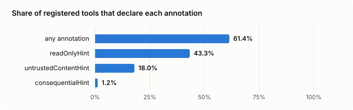
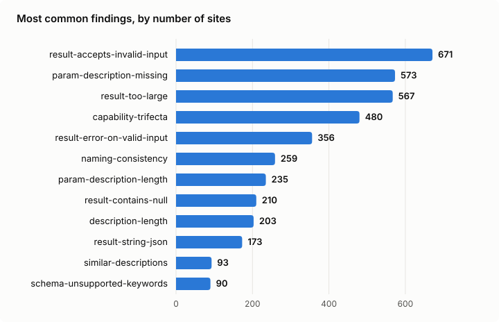
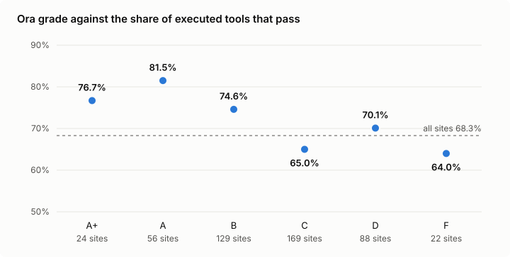

# The WebMCP Census, Q3 2026: I called every read-only tool in the directory

## At a glance

I loaded all 2,964 live sites in the webmcp.com directory in Chrome's own WebMCP implementation and called every tool that says it only reads. 1,748 sites registered tools the browser could see, 9,149 tools in total. Of the 3,842 tools the census could call safely, 68.3% passed every valid call. The surprise is a step earlier: 933 sites the directory lists with tools registered nothing Chrome could see.

## Why this exists

The first site I checked by hand lists three tools in the directory. Chrome saw none of them. The page had put its own object on `navigator.modelContext`, a surface Chrome 156 no longer has, and registered its tools there. Ora gives the same site an A, 93 out of 100.

There is no shortage of scores. [Ora](https://ora.ai) grades agent readiness across 116,000 sites, Lighthouse has an agentic-browsing category since May, and half a dozen free checkers read your HTML. None of them calls the tools. So I did. Chrome 157, due on 3 November, is where Chrome plans to ship WebMCP, which makes this a good week to know what agents will actually find.

The engine is [@swissspidy/webmcp-audit](https://www.npmjs.com/package/@swissspidy/webmcp-audit) by Pascal Birchler, with a harness around it for a crawl of this size. The method is in the [README](../README.md). The short version: one visit per site, up to three pages, only tools annotated `readOnlyHint: true` are called, with inputs taken from each tool's own schema, and no result is stored.

## What registers, and what the directory claims

The directory is generous. It lists 2,964 live sites, and the census saw tools on 1,748 of them.

| Outcome | Sites | Tools the directory lists for them |
| --- | --- | --- |
| Tools the browser saw | 1,748 | 9,118 (the census saw 9,149) |
| Nothing visible | 933 | 3,526 |
| Blocked, or answered with an error status | 192 | 746 |
| Every page failed or stopped answering | 70 | 369 |
| Skipped by robots.txt | 21 | 103 |

Where tools show up, the directory is accurate: 9,118 listed, 9,149 seen. The gap is the 933 sites that show nothing. The directory records how it found each site's tools, and that explains most of them. Of the 537 sites it marks as using a polyfill, 459 registered nothing native Chrome could see. Only 37 did. Another 454 sites the directory marks as using the spec API also showed nothing. The likely reasons are tools that register late, only after a click or a login, or that have since been removed.

> 933 sites in the directory register nothing Chrome can see.

28 sites are the plain case: they put their own object on `navigator.modelContext` and register there. That hides 135 tools. Chrome 156 dropped `navigator.modelContext` for `document.modelContext`, and a page that only checks the old name and fills it with its own object never notices.

## The common baseline

For the sites where tools did show up, the median site looks like this.

| Median site with tools | |
| --- | --- |
| Tools registered | 4 |
| Tools with any annotation | 71.4% |
| Tools declared read-only | 33.3% |
| Description length | 190 characters |
| Parameters with a description | 100% |
| Executed tools that pass (sites with something to call) | 87.5% |

That is a reasonable site. Four tools, mostly annotated, descriptions long enough to say what a tool does, every parameter described. If your site falls short of this, you are behind the median of people who bothered to ship WebMCP at all.

## Annotation hygiene

Annotations are the part agents have to trust blindly. `readOnlyHint` tells an agent it can call a tool without asking. `consequentialHint` tells it to stop and ask first. `untrustedContentHint` tells it the result contains text someone else wrote.

38.6% of all tools declare nothing. 959 sites have at least one tool without any annotation. `consequentialHint` sits at 1.2% of tools, on 49 sites, while the directory classes tools on 919 sites as acting rather than answering. Almost nobody tells an agent which tools change something.

> Almost nobody tells an agent which tools change something.

## The lint picture

The rule engine reads every tool definition. Most findings are about descriptions and schemas, and most are cheap.

`param-description-missing` hit 577 sites and 9,830 parameters. The ones that most often go without a description are `hotelId`, `slug`, `currency` and the check-in and check-out dates of hotel booking tools, so the agent has to guess a date format or which ID a hotel wants. `capability-trifecta` hit 482 sites: a page with tools that act, next to a tool that returns third-party text without saying so. That is the setup for a prompt injection, and it is a warning, not an error, because the census cannot tell whether that text is really dangerous. `naming-consistency` hit 261 sites, `search_products` next to `getCart` on the same page. Harmless for a model, but it shows nobody owned the tool set as a whole.

## What happens when you call them

Coming back to the original question: do the tools work? 817 of the 1,748 sites had nothing the census was allowed to call: no read-only tool, or only ones with a word like `send` in the name. On the other 931 sites it called 3,842 tools with 15,458 valid inputs. 85.7% of those calls came back without an error. 68.3% of the tools passed every valid call.

| What went wrong | Sites | Findings |
| --- | --- | --- |
| Invalid input accepted without an error | 673 | 6,701 |
| Result over 1,500 characters | 569 | 3,502 |
| Error on a valid input | 358 | 3,538 |
| `null` somewhere in the result | 212 | 1,402 |
| JSON returned as a string | 173 | 1,022 |
| Slower than 8 seconds | 29 | 54 |

The top line is the interesting one. 673 sites accept input their own schema says is wrong, a number where a string belongs or a value outside the enum, and answer as if nothing happened. An agent that makes a mistake never learns it made one. `null` in a result matters for a more boring reason: according to the audit engine's own rule, Chrome's Prompt API rejects it, so the call can fail on the agent's side even though the site answered.

## Read-only tools that post

The plan was to count read-only tools that write. It turns out a census cannot see that from the outside.

196 sites have read-only tools that sent a POST to their own origin during a call. Sorted by path, 46 sites post to an MCP relay. JSON-RPC always posts, so a site that forwards WebMCP calls to its own MCP server looks like a writer when it is reading. 51 post to analytics or telemetry endpoints, some of them the site's own logging of the tool call. 112 post to something else, and many of those are tool backends that take their arguments in a POST body, `/api/tools/get_apartment_details` and the like. A site can fall into more than one of these groups. GraphQL queries were already excluded during the crawl, because storefront APIs read that way.

So a POST is not a write, and the census does not fail a tool for one. 112 sites is the upper bound for read-only tools that really change something, and I would bet the real number is a small fraction of it. What this shows instead is that `readOnlyHint` cannot be verified from the outside. Agents will have to take it at its word.

> `readOnlyHint` cannot be verified from the outside.

## Instructions hidden in tool text

28 sites have tool text that reads as instructions to the agent, with role markers or hidden characters. 17 sites return results with instruction-like text and no `untrustedContentHint`. Small numbers, but these are the cases an agent cannot defend against on its own.

## What the sites that pass everything do differently

Among the 931 sites with tools the census could call, 454 passed every call. I compared them with the 477 where at least one tool failed.

| Mean per site | Every tool passed (454) | At least one failed (477) |
| --- | --- | --- |
| Tools registered | 5.2 | 7.9 |
| Tools with any annotation | 89.4% | 92.3% |
| Tools declared read-only | 74.9% | 73.0% |
| Median description length | 211 | 360 |
| Parameters with a description | 89.3% | 79.6% |
| Tools marked as returning third-party text | 18.8% | 30.4% |
| Tools that act | 28.6% | 32.1% |

The sites that pass everything are smaller. They register about five tools against eight, and part of that explains itself: fewer tools, fewer chances to fail. The rest does not. Their descriptions are much shorter, 211 characters against 360, and they describe more of their parameters. Fewer of their tools hand back text written by someone else. Annotations do not separate the two groups at all, both annotate about nine in ten tools. This is correlation, not proof, so treat it as a description of what good sites look like rather than a recipe.

## By category

Productivity and business tools pass most often, at 79.1%. Travel and events pass least, at 58.5%, and commerce sits at 63.5%. Both talk to live inventory and pricing backends, which is my best guess for why.

## Ora grade against execution

Sites with an A or A+ from Ora pass a bit more often than the rest, 81.5% and 76.7%. Below that the grade says little: D beats C, and F is close to C. That is not a criticism of Ora. Its score measures whether an agent can find you, read you and reach your tools. It does not call them, and it was never meant to. A good grade and working tools are two different things, and right now you need to check both.

## What is missing most

Three gaps stand out.

| Gap | Share |
| --- | --- |
| Tools without any annotation | 38.6% of tools |
| Sites with tools but no tool that acts, per the directory | 47.4% of sites |
| Sites with a single tool | 14.0% of sites |

Half the sites with tools only answer questions. They expose search and lookups, nothing that books, buys or submits. That is the safe way to start, and the census only calls read-only tools anyway, but it means agents can read most of the WebMCP web and act on very little of it. For SDK and plugin authors the opening is obvious: annotations generated by default, a validation step that rejects input the schema forbids, and a polyfill that hands over to the native API instead of hiding from it.

## Low-hanging fruits

Ranked by sites affected. Each fix is a few lines.

| Fix | Sites | Findings |
| --- | --- | --- |
| Declare `readOnlyHint` on tools that only read, `consequentialHint` on tools that act | 959 | 3,529 tools |
| Validate input against your own schema and throw on a mismatch | 673 | 6,701 |
| Describe every input property | 577 | 9,830 |
| Cap results at 1,500 characters, paginate or summarise | 569 | 3,502 |
| Return an empty string, 0 or an empty array instead of `null` | 212 | 1,402 |
| Write 20 to 600 characters that say what the tool does and when to call it | 203 | 707 |
| Return the object, not JSON inside a string | 173 | 1,022 |
| Flatten `$ref`, `oneOf`, `anyOf` and `allOf` into plain object schemas | 91 | 4,282 |
| Register on `document.modelContext` | 28 | 135 tools |

The `null` fix alone would flip 382 failing tools to passing. If you do one thing this week, do that, then add the annotations, then describe your parameters.

## The next thing to integrate

Adoption per spec feature, across the 1,748 sites with tools:

| Feature | Sites | Share |
| --- | --- | --- |
| Tools that act (per the directory) | 919 | 52.6% |
| Tool titles | 427 | 24.4% |
| `untrustedContentHint` | 357 | 20.4% |
| Declarative `<form toolname>` tools | 265 | 15.2% |
| `consequentialHint` | 49 | 2.8% |
| Cross-origin exposure (`exposedTo`) | 0 | 0% |

Declarative forms are real: 265 sites use them, which is the cheapest WebMCP there is. `untrustedContentHint` is getting there. `consequentialHint` is still paper, and that is the one I would integrate next. Chrome 157 is about to ship WebMCP, and agents need to know which acting tools on those 919 sites to confirm with a human first. Cross-origin exposure is unused. Nobody embeds another site's tools yet.

## Limits

The census sees what a fresh browser sees in a few seconds. Tools that register after the settle window, or only after a click or a login, are not counted. A page whose main thread stops answering is an error, even if it registered tools. A tool that needs more than 20 seconds fails, even if an agent would wait longer. Bot protection shows up as blocked. A read-only tool with a word like `send` or `delete` in its name is not called, even if it is harmless. And the directory decides the corpus, so a site that is not listed is not here.

A second audit of 30 random sites matched the first on 28. One site missed the page-load limit the second time, the other has a tool that passes only some of the time. The run itself took two attempts: this machine lost its connection twice during the first pass, and every site audited in or near those windows was audited again. Sites where every page failed got one more try, and 31 of 101 came back. robots.txt was first checked for the homepage only, so four pages it disallows, one each on four sites, had been visited. They are removed from the data, and the census now checks every page.

## Data, code and the skill

Everything is in the repository: `data/census.csv` with one row per site, `data/summary.json` with the headline numbers, and `data/learnings.json` with the baseline, the comparison of sites that pass every call with the rest, the gaps and the fixes above. Code is MIT, data CC BY 4.0. If your site is in here and you want it out, see `OPTOUT.md`.

For coding agents there is `skills/webmcp-readiness/SKILL.md`. Drop it into `.claude/skills/` or your agent's equivalent, and it carries the baseline, the failure modes and a checklist into the session where you write your tools.

## Conclusion

I went in expecting broken tools. The tools are mostly fine. What is broken is the step before: a third of the directory registers nothing Chrome can see, and almost nobody tells an agent which tools change something.

The next census is planned for 22 December 2026, with Chrome 157 shipped.
