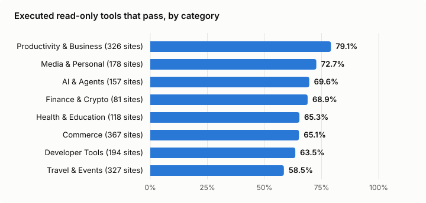

# The WebMCP Census, Q3 2026

The full report is on my blog: [The WebMCP Census, Q3 2026: I called 3,842 website tools to see what works](https://marcwieland.name/webmcp-census-q3-2026/).

On 13 October 2026 the census loaded the 2,964 live sites of the webmcp.com directory in Chromium 156 with WebMCP enabled. It called the tools labelled read-only (`readOnlyHint: true`), with inputs built from each tool's own schema.

- 1,748 sites registered tools Chrome could see, 9,149 in total.
- 933 sites the directory lists with tools registered nothing Chrome could see. 459 of the 537 sites the directory marks as using a polyfill are among them.
- 3,842 of the 9,149 tools are labelled read-only and have no risky name like `send` or `delete`, so the census called them. They sit on 931 sites. 5,194 tools are not labelled read-only, so the census left them alone. That does not make them tools that change something: 3,529 of them carry no label at all. 35 read-only tools on 6 sites were not reached before the site's 180 s ran out.
- Each called tool got about four calls with valid input, 15,458 in total. 85.7% of those calls came back without an error.
- 68.3% of the 3,842 tools worked on every one of their calls. One bad call is enough to count a tool as failed: an error, a `null` in the result or a result that cannot be serialised.
- 38.6% of tools carry no annotation at all. `consequentialHint` is on 1.2% of tools.
- The most common failure: 673 sites accept input their own schema rejects.

The numbers come from [`data/summary.json`](../data/summary.json) and [`data/learnings.json`](../data/learnings.json), the method and its limits are in [METHOD.md](../METHOD.md). The other charts: [top findings](top-findings.svg), [annotations](annotations.svg), [Ora grade against execution](ora-vs-execution.svg).
